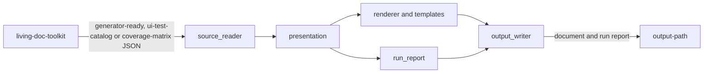

# Living Documentation Generator for Markdown

## Purpose

A composite GitHub Action (`action.yml`, then `main.py`) that renders one `living-doc-toolkit` output as one Markdown
document with a run report. It is the generate stage of the living-doc pipeline.

- Document types: `technical-project`, `ui-test-catalog`, `coverage-matrix`.
- Not responsible for: collecting (collectors), transforming or enriching data (`living-doc-toolkit`), contract
  models and schemas (`living-doc-utilities`).
- AI-free: deterministic Python and Jinja2 only, no LLM and no API call in a run (`CONTRIBUTING.md` § AI-free
  Principle).

## Tech stack

- Python `>=3.10`; CI runs 3.10 to 3.14.
- `living-doc-utilities==0.8.1`: the contract models, `read_artifact`, the codes, `setup_logging`, `safe_href`.
- `Jinja2==3.1.6` with `StrictUndefined`; one template folder per document type under `templates/`.
- pytest + pytest-cov, ruff, Black, Pylint, mypy; `PyYAML` and `markdown-it-py` for the tests only.

## Structure

| Path | What it is |
|---|---|
| `action.yml`, `main.py` | The action: the venv step, then `main.py` validates, reads, presents, renders and writes |
| `generator_markdown/action_inputs.py` | `INPUT_*` validation: `ActionInputs`, `DocumentType`, `ActionInputError` |
| `generator_markdown/source_reader.py` | `source-path` through `read_artifact`: the contract per document type, the one-line errors |
| `generator_markdown/presentation.py` | Input model plus its `document.view` to frozen presentation dataclasses; the render manifest |
| `generator_markdown/renderer.py` | The Jinja2 environment, escaping, `TEMPLATE_KEY_MISSING` |
| `generator_markdown/run_report.py`, `output_writer.py` | The run report; the one write into `output-path` |
| `templates/<document-type>/` | Render the presentation model only; no logic |
| `tools/` | `write_sample_inputs.py` (sample inputs for the debug run and CI), `local_integration.py` (the local run's report), `check_runtime_requirements.py` |
| `local-integration.sh`, `.env.local.example` | The operator's run of the three document types outside any workflow |
| `tests/` | Unit tests mirroring the package, shared fixtures in `conftest.py`, golden snapshots under `tests/fixtures/golden/`, the page checks in `tests/docs/` |
| `.github/workflows/` | `test.yml` runs the `make` targets, the tests also on a page-only change (`docs_changed`); `integration_test.yml` runs the action through `uses: ./`; `link-check.yml` runs lychee |
| `README.md`, `docs/action.md` | The entry page; the action's full reference (inputs, output, files, document types, errors) |
| `DEVELOPER.md`, `CONTRIBUTING.md` | Solo pages: development, with the design rules and the page rules; contribution conventions |

## How it fits together

- `main.py::run`: `ActionInputs.from_environment`, `read_source`, `present`, `render`, `run_report`, `write_output`,
  then `set_action_output`. Each failure logs one line and exits 1; nothing is written before the render succeeds.

## Contracts

- All owned by `living-doc-utilities`; this repository defines none and commits no schema.
- Reads, by `document-type`: `generator-ready`, `ui-test-catalog`, `coverage-matrix`. A collector output
  (`doc-source`, `doc-entities`, `ui-tests`) is rejected with the `living-doc-toolkit` command that writes the input.
- The canon: `living-doc-utilities` `docs/contracts/rendering.md` (fields by view), `docs/contracts/errors.md`
  (codes), `docs/contracts.md` (the contracts, R5 on read); `living-doc` `docs/introduction/principles.md` (the
  frame), `docs/reference/glossary.md` (the terms). Links to `living-doc-utilities` point at `master`.

## Running it

- Commands: `AGENTS.md` § This project (`make install`, `make qa`, `make test`).
- Debug run: the `INPUT_*` variables, then `python3 main.py` (`DEVELOPER.md` § Debug run).
- `./local-integration.sh [--check]`: the three document types over `.env.local`'s inputs, in
  `.venv-local-integration/` (`DEVELOPER.md` § Local Integration Run). No workflow runs it.

## Conventions

- Pages follow `DEVELOPER.md` § Writing documentation, their only copy; `tests/docs/pages.py::APPROVED_PAGES` lists
  them, and a new page goes there and is linked from `README.md`. `CONTEXT.md`, `AGENTS.md`, `CLAUDE.md`, and the
  Markdown under `.github/`, `.claude/`, `.local_context/` and `tests/fixtures/` are not pages.
- A page states facts without `path::symbol`, except `DEVELOPER.md`; the `CONTEXT.md` beside the code maps them in
  `## Code map` (`tests/docs/pages.py::CODE_MAPS`). A changed fact updates both.
- Every `uses:` of this action on a page names one release, `@v0.1.0`.
- There is no `SPEC.md`: the design rules are `DEVELOPER.md` § Design rules.
- Every failure `main.py` reports is one line and exit code 1, naming the input where there is one, with `!r` on a
  value that may hold a line break; the tests assert the exact text.
- The presentation module imports only the contract models and returns frozen dataclasses; a template only renders.
- Every link passes `safe_href`, and every printed value is escaped (`DEVELOPER.md` § Design rules).
- Log through `setup_logging` with lazy `%` formatting; tests use `pytest`, never `unittest`.

## Key decisions

- No contract model or schema here: the contracts are `living-doc-utilities`' (`make no-vendored-schemas`).
- `requirements.txt` is runtime-only, because the action installs it on every run (`make runtime-requirements`).
- The action runs in its own venv under `$RUNNER_TEMP`, so it never changes the caller's interpreter
  (`DEVELOPER.md` § Action venv).

## Invariants and gotchas

- `ActionInputs.from_environment` checks the inputs in `action.yml` order and stops at the first invalid one.
- The golden snapshots `tests/fixtures/golden/<document-type>/<view>.md` compare byte for byte; rewrite them with
  `UPDATE_GOLDEN=1 pytest tests/generator_markdown/test_golden.py` and review the diff. `link-check.yml` skips them:
  their links are made up.
- `make lint` and `make format-check` read `git ls-files`, and so does the page list check: `git add` a new file
  before checking it.
- `.env.local.example`'s keys must equal the script's `KEYS` (`tests/test_local_integration.py`).
- Some tests fail on Windows only: a directory read, a file name with a line break, the venv's `bin/` layout, the
  bash script run end to end. CI runs on ubuntu.
- The release-notes configuration is the same in every `living-doc*` repository (AbsaOSS/living-doc#97):
  `release_draft.yml`'s `release-notes-title` and `chapters` through `row-format-link-pr`,
  `check_pr_release_notes.yml`'s `skip-labels`, and both workflows' `permissions:`. Change it in all of them together
  → [what it covers and how the generator sorts](https://github.com/AbsaOSS/living-doc/blob/master/.github/CONTEXT.md)
- `.local_context/` is private and never committed.

## Code map

What realises each fact of [`docs/action.md`](docs/action.md), the action's reference:

- Python 3.10 or later on `PATH`, checked before anything is created → `action.yml::sys.version_info`
- `python3` first, then `python` → `action.yml::python3`
- The action's own venv under `$RUNNER_TEMP`, built with `pip` from `requirements.txt` → `action.yml::living-doc-generator-markdown-venv`
- The caller's interpreter, `PATH` and environment stay as they were → `tests/test_action_yml.py::test_a_good_install_hands_the_venv_interpreter_to_the_run_step_and_nothing_to_the_job`
- Linux runners only: the venv's `bin/` layout → `tests/test_action_yml.py::test_a_good_install_hands_the_venv_interpreter_to_the_run_step_and_nothing_to_the_job`
- The input file comes from a `living-doc-toolkit` step → toolkit
- One local file read, no API call → `generator_markdown/source_reader.py::read_source`
- The document types → `generator_markdown/action_inputs.py::DocumentType`
- The contract each document type reads → `generator_markdown/source_reader.py::CONTRACT_NAMES`
- The `living-doc-toolkit` command that writes it → `generator_markdown/source_reader.py::TOOLKIT_COMMANDS`
- The default titles → `generator_markdown/presentation.py::DEFAULT_TITLES`
- `document-title` first, then a technical project's own `document.title` → `generator_markdown/presentation.py::_technical_project`
- The view is the input's `document.view` → `generator_markdown/presentation.py::_technical_project`, `generator_markdown/presentation.py::_ui_test_catalog` and `generator_markdown/presentation.py::_coverage_matrix`
- The fields each view shows → utilities
- The document-type table equals the code → `tests/docs/test_option_lists.py::test_the_document_type_table_equals_the_code`
- The input table equals `action.yml` → `tests/docs/test_option_lists.py::test_the_input_table_equals_action_yml`
- An empty `output-path` is the default → `generator_markdown/action_inputs.py::ActionInputs.from_environment` and `generator_markdown/action_inputs.py::DEFAULT_OUTPUT_PATH`
- `verbose-logging` or `RUNNER_DEBUG=1` logs at DEBUG → utilities
- The output table equals `action.yml` → `tests/docs/test_option_lists.py::test_the_output_table_equals_action_yml`
- `output-path`, resolved to an absolute path → `generator_markdown/action_inputs.py::ActionInputs.from_environment`
- The `output-path` output, set once both files are written → `main.py::run`
- The two file names → `generator_markdown/output_writer.py::document_file_name` and `generator_markdown/output_writer.py::run_report_file_name`
- The directory is created when missing; no other file is touched → `generator_markdown/output_writer.py::write_output`
- What the run report holds → `generator_markdown/run_report.py::run_report`
- Its counts equal the input's `metadata.stats.cardinality` → `tests/generator_markdown/test_run_report.py::test_the_counts_come_from_the_input_model_and_equal_its_cardinality`
- A failed `pip install` fails the step with pip's own output → `action.yml::requirements.txt`
- The venv step's three lines → `tests/test_action_yml.py::test_a_python_below_3_10_fails_with_one_error_line_before_creating_a_venv`, `tests/test_action_yml.py::test_a_failed_venv_create_fails_with_one_error_line` and `tests/test_action_yml.py::test_requirements_missing_from_the_venv_fail_the_import_check_with_one_error_line`
- The input lines, in `action.yml` order → `generator_markdown/action_inputs.py::ActionInputs.from_environment`
- The `source-path` lines, a collector output's and another document type's included → `generator_markdown/source_reader.py::read_source` and `generator_markdown/source_reader.py::_contract_error_line`
- `INVALID_CONTRACT_ID` with the pin hint → `tests/generator_markdown/test_source_reader.py::test_a_version_of_the_expected_contract_the_installed_utilities_lacks_is_rejected_with_the_pin_hint`
- `TEMPLATE_KEY_MISSING`, never an empty section → `generator_markdown/renderer.py::render`
- The `output-path` lines → `generator_markdown/output_writer.py::OutputError` and `main.py::run`
- Every failure `main.py` reports is one line and exit code 1 → `main.py::run`
- The codes, and the order a consumer checks an input in → utilities
